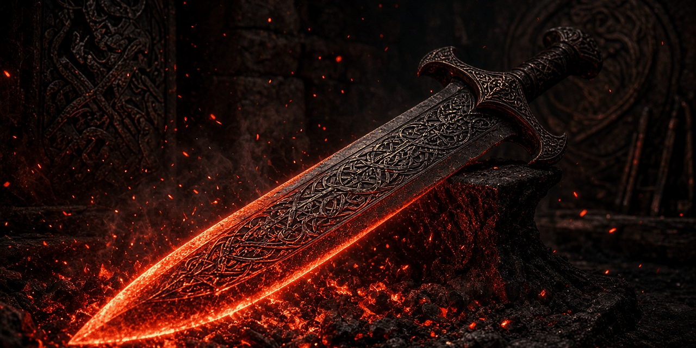

# Ember Smithing

A Skyrim Special Edition mod that adds more to do at the forge. Put vanilla weapons back into the fire for three tiers of heat-tempering, and engrave vanilla armor with protective runes. All new records, crafted at the vanilla forges and improved at the vanilla grindstones and workbenches.

**Status: v0.1.0, early beta.** It passes every automated check in the build (plugin validation, a type check of every vanilla reference, byte-exact round trip, FOMOD schema) but has not been playtested in-game yet. Expect rough edges and please report what you find. See [docs/TESTING.md](docs/TESTING.md).

- Game: Skyrim Special Edition / Anniversary Edition 1.6.x (also fine on 1.5.97). Works on Windows and on Linux through Proton.
- Requirements: none beyond the base game. No SKSE, no SkyUI, no DLC, no Creation Club content.
- Plugin: `EmberSmithing.esp`, ESL-flagged (537 records, FormIDs 0x800–0xA18, well inside the ESL range), Skyrim.esm is the only master. No vanilla records edited, no scripts.
- Compatible with [Blackshield Company](https://github.com/synthalorian/blackshield-company), [Daedric Ledger: Bounties of Oblivion](https://github.com/synthalorian/bounties-of-oblivion), [Contract Hunter](https://github.com/synthalorian/contract-hunter) and [Steel Oath](https://github.com/synthalorian/steel-oath): separate prefix (`EMB_`), no shared records.

## Heat-tempering (forge)

Covers 42 vanilla weapons: Iron, Steel, Orcish, Dwarven, Elven, Glass and Ebony swords, war axes, maces, greatswords, battleaxes and warhammers.

| Tier | Base damage | Value | Needs | Recipe |
|---|---|---|---|---|
| Heat-Tempered | +10% (at least +1) | ×1.3 | Smithing 20 + the material's perk | the vanilla weapon, 1 ingot, 2 firewood |
| Ember-Forged | +20% (at least +2) | ×1.7 | Smithing 45 + perk | the Heat-Tempered weapon, 1 ingot, 2 charcoal |
| Dragonfire | +30% (at least +3) | ×2.2 | Smithing 70 + perk | the Ember-Forged weapon, 2 ingots, 1 fire salts |

"Ingot" means the material's usual tempering material: iron, steel, orichalcum, dwarven metal, refined moonstone, refined malachite or ebony. Weight, speed, reach and stagger stay as in vanilla. Every tier can still be improved at a grindstone and enchanted as usual. Exact numbers for every weapon are in [docs/ITEMS.md](docs/ITEMS.md).

## Engraving (forge)

Covers 17 vanilla pieces: Iron, Steel, Dwarven, Orcish, Ebony, Hide, Leather, Elven and Glass armor (cuirass), plus the matching shields (leather has none in vanilla).

| Engraving | Effect | Recipe |
|---|---|---|
| Ember-Engraved | Resist Fire 20% | the vanilla piece, 1 silver ingot, 1 fire salts |
| Hearth-Engraved | Resist Frost 20% | the vanilla piece, 1 silver ingot, 1 frost salts |
| Bellows-Engraved | Stamina regenerates 25% faster | the vanilla piece, 1 silver ingot, 2 charcoal |

Needs Smithing 30 and the material's perk. Armor rating and weight stay as in vanilla. Engraved pieces count as enchanted: they can be improved at a workbench with Arcane Blacksmith, can't be enchanted again, and can't be disenchanted.

Recipes only show up at the forge while you carry the item they start from, so the menu doesn't fill up with recipes you can't use.

## Install

Grab `EmberSmithing-<version>.zip` from [Releases](https://github.com/synthalorian/ember-smithing/releases) (FOMOD installer).

- **Mod Organizer 2**: *Install a new mod from an archive*, pick the zip, enable `EmberSmithing.esp`.
- **Vortex**: drag the zip into the Mods page, install and enable it.
- **Manual (Linux/Proton)**: copy `EmberSmithing.esp` from `00 Core/` into `.../steamapps/common/Skyrim Special Edition/Data/`, then add `*EmberSmithing.esp` to `.../steamapps/compatdata/489830/pfx/drive_c/users/steamuser/AppData/Local/Skyrim Special Edition/Plugins.txt`.

Safe to add or remove at any time (no scripts). Items made with the mod disappear if you uninstall it.

## Build from source

`./build.sh` on Linux builds the release zip from this repo: the plugin is generated from C# with [Mutagen](https://github.com/Mutagen-Modding/Mutagen) and validated (ESL range, masters, links, byte-exact round trip), and the FOMOD is schema-checked and zipped reproducibly. Needs .NET SDK 9+, python3 and optionally xmllint. See [tools/modkit/README.md](tools/modkit/README.md).

`src/plugin/vanilla-items.json` describes the vanilla weapons and armor the mod builds on (FormIDs, mesh paths, sound and keyword references, vanilla stats). `src/plugin/formids.json` pins every record's FormID. Never edit or reuse entries.

## Layout

```
src/plugin/       Mutagen plugin generator, vanilla item data, pinned FormIDs
fomod/            FOMOD installer config
docs/             Item reference, testing checklist, design notes, Nexus page and upload fields
tools/modkit/     Shared tooling for the mod series
build.sh          One-command build
```

## Support

Donations are optional. Nothing in the mod is gated on them.

- GitHub Sponsors: https://github.com/sponsors/synthalorian
- Ko-fi: https://ko-fi.com/synthalorian

## Credits and licenses

- Code in this repo: MIT (see `LICENSE`).
- [Mutagen](https://github.com/Mutagen-Modding/Mutagen) by Noggog and contributors (GPL-3.0), used as a build tool, not redistributed.
- Vanilla weapon and armor stats from [UESP](https://en.uesp.net/wiki/Skyrim:Weapons).
- FOMOD schema from [GandaG/fomod-schema](https://github.com/GandaG/fomod-schema) (MIT).
- Skyrim and its assets belong to Bethesda Softworks. This repo contains no Bethesda assets or script sources; the plugin references vanilla records by FormID and vanilla meshes by path.

## Support

Donations are optional. Nothing in the mod is gated on them.

- GitHub Sponsors: https://github.com/sponsors/synthalorian
- Ko-fi: https://ko-fi.com/synthalorian

<p><br><sub>A <a href="https://github.com/synthalorian">Blackshield Company</a> mod.</sub></p>
